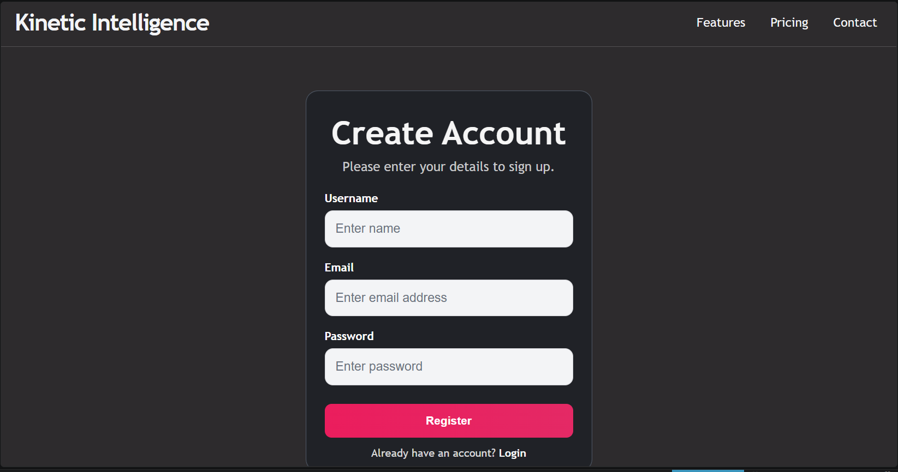
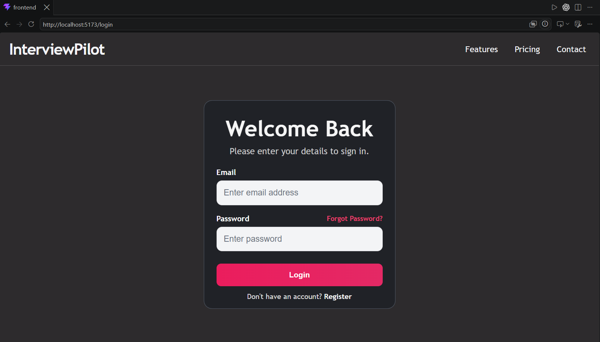
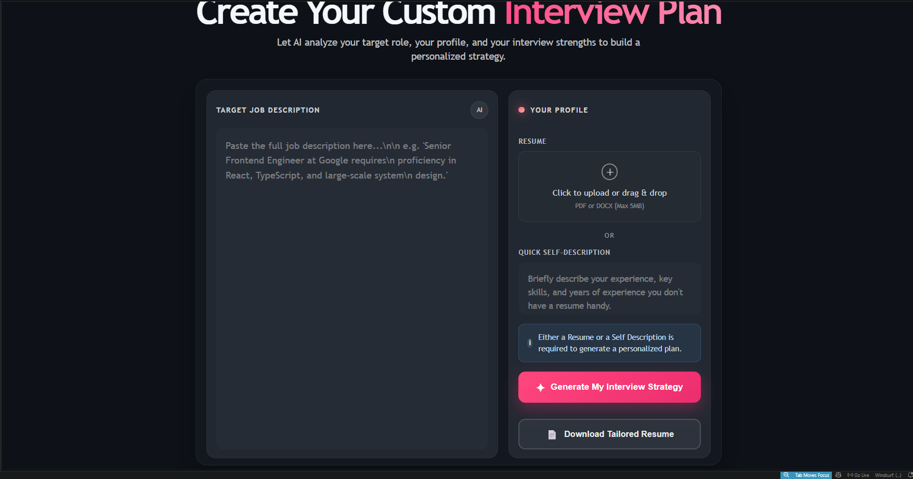
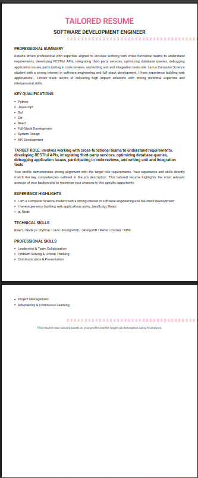
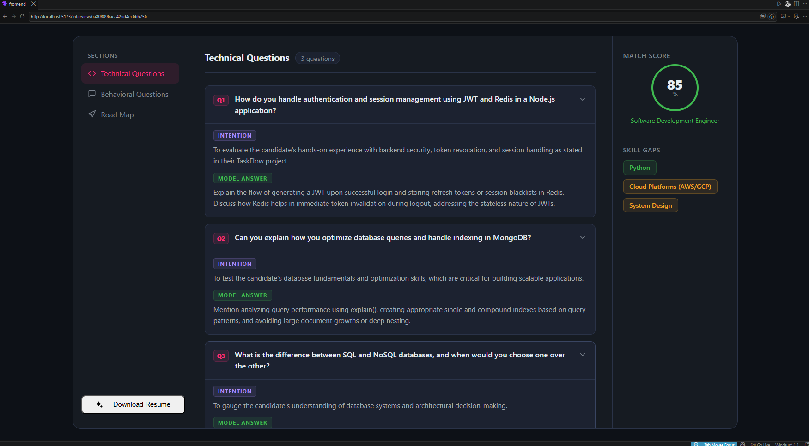

# GenAI Interview Planner

An AI-powered full-stack web application that builds a personalized interview strategy for you. Paste a target job description, upload your resume, and let Google Gemini analyze your profile against the role to generate a custom interview plan and report.

Built with React (Vite), Node.js, Express, MongoDB Atlas, and the Google Gemini API.

## 🚀 Live Links

- **Frontend:** https://genai-frontend.onrender.com
- **Backend API:** https://genai-backend-api.onrender.com

> Hosted on Render's free tier, so the first request after a period of inactivity may take a few seconds to wake up.

## ✨ Features

- **User authentication**: register, log in, and log out securely.
- **Custom interview plan**: provide a target job description and your profile, and the AI builds a strategy around the role and your strengths.
- **Resume analysis**: upload your resume so the AI can match your skills and experience to the job.
- **AI-generated report**: a structured report with insights and preparation guidance for your interview.
- **Dashboard**: view and manage your generated plans in one place.
- **Responsive, modern UI**: dark-themed interface built with React 19, Vite, and Tailwind CSS.
- **Production-ready architecture**: decoupled frontend and backend, environment-based secrets, and CORS configuration.

## 📸 Screenshots

### Register


### Login


### Dashboard


### Resume Upload


### Interview Report


## 🛠 Tech Stack

| Layer | Technology |
|-------|------------|
| Frontend | React 19, Vite, Tailwind CSS |
| Backend | Node.js, Express.js |
| Database | MongoDB Atlas, Mongoose |
| AI Service | Google GenAI SDK (Gemini API) |
| Deployment | Render |

## 📁 Project Structure

```
genAI/
├── Backend/            # Express server, controllers, routes, models
├── Frontend/           # React + Vite client
├── docs/
│   └── screenshots/    # App screenshots used in this README
├── .gitignore
└── README.md
```

## ⚙️ Local Setup

### Prerequisites

- Node.js 18+
- A MongoDB Atlas connection string
- A Google Gemini API key

### 1. Clone the repository

```bash
git clone https://github.com/Samarth-Gupta30/genAI.git
cd genAI
```

### 2. Backend

```bash
cd Backend
npm install
```

Create a `.env` file in `Backend/` (adjust names to match your code):

```env
PORT=5000
MONGODB_URI=your_mongodb_atlas_connection_string
JWT_SECRET=your_jwt_secret
GEMINI_API_KEY=your_gemini_api_key
FRONTEND_URL=http://localhost:5173
```

Start the server:

```bash
npm run dev
```

### 3. Frontend

Open a second terminal:

```bash
cd Frontend
npm install
```

Create a `.env` file in `Frontend/`:

```env
VITE_API_BASE_URL=http://localhost:3000
```

Start the dev server:

```bash
npm run dev
```

The app will be available at **http://localhost:5173**.

## 🌐 Deployment

- **Frontend** and **Backend** are deployed as separate services on Render.
- Secrets (MongoDB URI, Gemini API key, JWT secret) are injected via Render environment variables, never committed to the repo.
- CORS on the backend is configured to allow only the deployed frontend origin.

## 🔮 Future Improvements

- Save and compare multiple interview plans per role
- Export reports as PDF
- Mock interview question practice mode

## 👤 Author

**Samarth Gupta**
GitHub: [@Samarth-Gupta30](https://github.com/Samarth-Gupta30)
